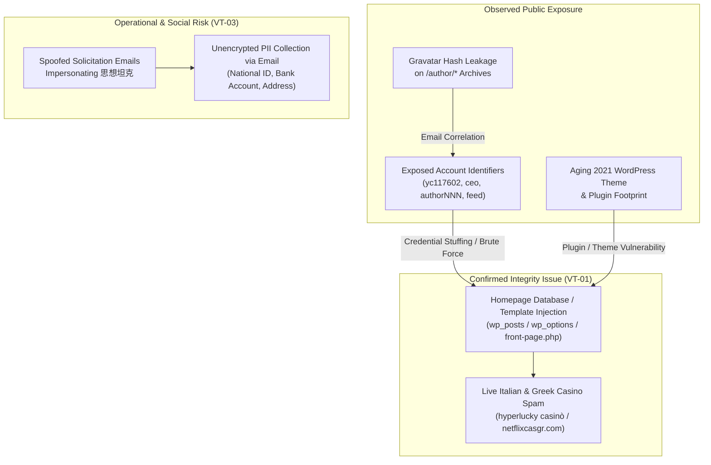

# Security Assessment Report: `voicettank.org` (思想坦克)

> [!CAUTION]
> **Active Content Compromise Detected (High Priority):** Passive inspection of `https://voicettank.org/` confirmed unauthorized foreign-language gambling/casino SEO spam injected directly into the live homepage above the site footer. This indicates either a compromised WordPress administrator/editor account, a vulnerable third-party plugin/theme allowing content or widget modification, or server-level template tampering.

---

## 1. Executive Summary

Using the **Philharmonic** orchestration workflow, two parallel passive OSINT tracks evaluated the publicly accessible footprint and search-indexed state of `voicettank.org`.

| ID | Finding | Severity | Category | Status |
| :--- | :--- | :--- | :--- | :--- |
| **VT-01** | **Unauthorized SEO / Casino Link Spam Injection on Homepage** | **Critical / High** | Integrity Compromise | Confirmed Live |
| **VT-02** | **WordPress Privileged/Staff Account & Author Slug Enumeration** | **Medium** | Information Disclosure / Auth | Confirmed Live |
| **VT-03** | **Active Email Impersonation & High-Risk PII Collection via Email** | **Medium** | Operational / Email Security | Confirmed Live |
| **VT-04** | **Gravatar SHA-256/MD5 Hash Disclosure on Author Archives** | **Low** | Information Disclosure | Confirmed Live |
| **VT-05** | **Exposed Orphan/Stub Pages & Uncanonicalized Legacy Routes** | **Low / Info** | Configuration / Hygiene | Confirmed Live |

---

## 2. Detailed Findings & Technical Analysis

### VT-01: Unauthorized SEO / Casino Link Spam Injection on Homepage (`Critical / High`)

- **Evidence:**
  On the live homepage (`https://voicettank.org/`), immediately beneath the *「書摘選讀」* (Book Excerpts) section and directly above the copyright footer (`@2021 - All Right Reserved. Designed and Developed by 台灣智庫`), two unauthorized paragraphs of foreign-language gambling spam are rendered:
  1. **Italian Casino Spam:**
     > `Chi preferisce il svago online può scoprire bonus, giochi e offerte su hyperlucky casinò, confrontando i dettagli prima di iniziare a giocare.`
  2. **Greek Casino Spam:**
     > `Για μια γρήγορη σύγκριση προσφορών, μπόνους και μεθόδων πληρωμής, επισκεφτείτε τη σελίδα https://netflixcasgr.com, όπου μπορείτε να δείτε αναλυτικές πληροφορίες πριν επιλέξετε έναν πάροχο για καζίνο και στοιχήματα με υπευθυνότητα.`
- **Blast-Radius & Localization Analysis:**
  Passive verification across category pages (`/category/politics/`, `/category/column/`, `/category/library/`), section pages (`/international/`), recent articles (`/20260715-2/`, `/演算法短影音與社群選戰/`), and static pages (`/歡迎投稿/`) showed that **the spam blocks do not appear on inner pages** and **no unconditional page-load redirects (`301`/`302`/JS `window.location`) fire on normal visits**.
  - This localization indicates the injection is stored inside the **homepage's specific page-builder layout/post content** (`wp_posts`), a **homepage-only widget** (`wp_options`), or the theme's **`front-page.php` / `home.php`** template rather than the global `footer.php`.
- **Why There Are No Unconditional Auto-Redirects (Campaign Mechanics & Redirect Chain):**
  Cross-domain OSINT correlation shows `voicettank.org` was hit by the **same automated WordPress SEO parasite campaign** currently infecting other unrelated WordPress sites worldwide (e.g., `martinsvillegolfclub.com`, `sekgroup.org.uk/policies/`, and `paulbyrnesplumbing.com.au/2026/10/27/beyond-the-welcome-bonu/`), which injects identical Italian (`hyperlucky casinò`) and Greek (`netflixcasgr.com`) blurbs:
  1. **Silent Link-Juice Siphoning (No Forced Redirect on `voicettank.org`):** The attackers intentionally avoid auto-redirecting `voicettank.org` visitors because an immediate redirect to a Greek/Italian casino would alert the editorial team (`台灣智庫`) and cause Google to de-index `voicettank.org`, destroying the high Domain Authority (`PageRank`) the attackers are harvesting.
  2. **Two-Hop Outbound Affiliate Redirects:** Instead of redirecting the host page, the injected anchor links point to bridge/doorway domains (`netflixcasgr.com` and `hyperlucky.casino` / `hyper-lucky.org` / `hyperlucky-casino.site`), which in turn use affiliate redirect chains (`Συνεργατικοί Σύνδεσμοι`) to funnel traffic to offshore Curacao-licensed crypto casinos (`BrightSky Ltd`).
  3. **Risk of Conditional / Cloaked Redirects on the Server:** WordPress malware in this family frequently pairs static footer/content link injection with conditional PHP hooks (`template_redirect` / `wp_head`) that only issue a `302` redirect when a visitor arrives from a Google search `Referer` matching gambling keywords and is not logged into WordPress (`!is_user_logged_in()`).
- **Security Impact:**
  - Indicates unauthorized write access to the WordPress database or filesystem.
  - Harms domain reputation and search engine trust (Google Safe Browsing / Search Console manual spam actions).
  - If achieved via a compromised administrator/editor account or vulnerable plugin, the attacker may also have planted persistent backdoors (e.g., rogue admin users, `mu-plugins`, or PHP web shells under `/wp-content/`).

---

### VT-02: WordPress Privileged/Staff Account & Author Slug Enumeration (`Medium`)

- **Evidence:**
  1. **Creator/Staff Handle Leakage on Static Pages:** The public submissions page (`https://voicettank.org/歡迎投稿/`) outputs the internal page creator's account handle (`yc117602`) in the page metadata (`Home 歡迎投稿 yc117602`).
  2. **Role-Based & Personal Login Slugs:** Search-indexed `/author/` archives expose internal WordPress `user_nicename` identifiers that frequently mirror `user_login` credentials:
     - `/author/ceo/` (role-based high-value target)
     - `/author/feed/` (anomalous legacy account with content dating to Oct 2020)
     - `/author/yuming19840405/` (handle containing a full date pattern)
     - `/author/tcp0625/`, `/author/laird520/`, `/author/iclai/`, `/author/austin-wang/`
  3. **Sequential Author Slugs:** Numerous contributor accounts follow a predictable sequential pattern (`/author/author605/`, `/author/author639/`, `/author/author659/`, `/author/author700/`, `/author/author747/`).
- **Security Impact:**
  By default in WordPress, `user_nicename` is auto-generated from `user_login`. Exposing privileged and staff identifiers (`yc117602`, `ceo`, `feed`) eliminates half of the authentication factor for automated credential-stuffing or brute-force attacks against `wp-login.php` and `xmlrpc.php`.

---

### VT-03: Active Email Impersonation & High-Risk PII Collection Workflow (`Medium`)

- **Evidence:**
  On `https://voicettank.org/歡迎投稿/`, the site publishes an explicit security notice warning contributors that third parties have been impersonating Voicettank (`思想坦克`) via email to solicit manuscripts, reminding users to verify the address `voice@voicettank.org`.
  On the same page, contributors are instructed to email sensitive Personal Identifiable Information (PII) for honorarium processing:
  - Full legal name (`真實姓名`)
  - **Taiwan National ID number (`身分證字號`)**
  - **Residential & household registration address (`聯絡及戶籍地址`)**
  - **Bank account details (`銀行帳戶資訊`)**
  - Phone number (`電話`)
- **Security Impact:**
  - Soliciting National ID numbers and bank account details over standard, unencrypted email creates a high-value target for both external spear-phishing/spoofing actors and anyone who compromises the `voice@voicettank.org` mailbox.
  - If the domain's DNS lacks strict DMARC (`p=reject` or `p=quarantine`), SPF (`-all`), and DKIM enforcement, attackers can trivially spoof `voice@voicettank.org` to harvest contributors' National IDs and banking details.

---

### VT-04: Gravatar Hash Disclosure on Public Author Archives (`Low`)

- **Evidence:**
  Indexed author archives embed Gravatar URLs containing cryptographic hashes of the account's registered email address (e.g., `https://secure.gravatar.com/avatar/4a28735c4ef2a707e34e5a53d5b0fd01217d90b4d97dc25334c5a2accf05dce6?s=250&d=mm&r=g` on `/author/author659/`, alongside cached files under `/wp-content/uploads/gravatar/`).
- **Security Impact:**
  Attackers can correlate or crack email hashes against known domain patterns (`@voicettank.org`, `@taiwanthinktank.org`, or common webmail providers) to identify the exact login email addresses of editors and administrators.

---

### VT-05: Orphan Template Pages & Legacy Migration Routes (`Low / Informational`)

- **Evidence:**
  - `https://voicettank.org/schedule/` ("Schedule – 思想坦克｜Voicettank") is publicly indexed and appears to be an unremoved theme demo or stub page.
  - `https://voicettank.org/single-post/` and multiple 2019–2021 articles (`/single-post/2021032801/`, `/single-post/2019/06/09/060901/`) remain indexed from a prior CMS migration alongside a fallback page stating *"這是舊網站的網址唷，請點擊返回首頁"*.
- **Security Impact:**
  Orphan pages and legacy templates expand the CMS attack surface (especially if backed by legacy shortcodes or page-builder templates) and dilute search indexing hygiene.

---

## 3. Prioritized Defensive Remediation Plan

> [!IMPORTANT]
> Because **VT-01** confirms unauthorized content modification on the homepage, remediation must begin with **incident containment and persistence hunting**, not merely deleting the visible spam text.

### Phase 1: Immediate Incident Response (VT-01)
1. **Clean & Audit the Homepage Source:**
   - Inspect the homepage post record in `wp_posts` (including `post_content` and page-builder meta in `wp_postmeta`), active widgets in `wp_options` (`sidebars_widgets`, `widget_text`, `widget_custom_html`), and the active theme's `front-page.php`, `home.php`, and `functions.php`.
   - Search the database for injected external links (`netflixcasgr`, `hyperlucky`, `casinò`, `καζίνο`) and hidden CSS/JS (`display:none`, `visibility:hidden`).
2. **Hunt for Persistence & Backdoors:**
   - Audit all WordPress administrator and editor accounts in `wp_users` and `wp_usermeta` (`wp_capabilities`); remove or disable unrecognized accounts and inspect legacy accounts like `feed`, `ceo`, and `yc117602`.
   - Scan `/wp-content/plugins/`, `/wp-content/mu-plugins/`, `/wp-content/themes/`, and `/wp-content/uploads/` for unauthorized `.php` files or recently modified scripts. Ensure PHP execution is strictly disabled inside `/wp-content/uploads/`.
3. **Update Core, Plugins, and Theme & Rotate Credentials:**
   - Update WordPress core and all plugins/themes to their latest patched versions, removing any abandoned or unmaintained plugins from the 2021 build.
   - Force a password reset for all privileged WordPress users, rotate `wp-config.php` authentication salts (`AUTH_KEY`, `SECURE_AUTH_KEY`, `LOGGED_IN_KEY`, `NONCE_KEY`), and rotate database credentials.

### Phase 2: Authentication & Enumeration Hardening (VT-02, VT-04)
1. **Enforce Multi-Factor Authentication (MFA) & Limit Login Attempts:**
   - Require MFA for all Administrator, Editor, and Author accounts.
   - Disable `xmlrpc.php` if not required, and protect `/wp-login.php` with rate-limiting / WAF rules.
2. **Decouple Display Slugs from Login Usernames:**
   - Remove the author username output (`yc117602`) from static `page.php` templates.
   - Change `user_nicename` and `display_name` values so they never match `user_login`, and block unauthenticated `/?author=N` enumeration redirects and `/wp-json/wp/v2/users` listing.
3. **Disable Remote Gravatar Hash Leakage:**
   - Use local generic avatars or disable Gravatar lookups in **Settings → Discussion** so internal staff email hashes are not broadcast in public HTML.

### Phase 3: Email Authentication & PII Workflow Hardening (VT-03, VT-05)
1. **Harden Domain Email Authentication (SPF / DKIM / DMARC):**
   - Publish a strict SPF policy (`v=spf1 ... -all`), enable DKIM signing for `voicettank.org`, and configure DMARC with `p=quarantine` or `p=reject` to block spoofed manuscript solicitation emails.
2. **Replace Email-Based PII Collection:**
   - Stop collecting Taiwan National ID numbers (`身分證字號`) and bank account details in initial manuscript submission emails. Collect tax/payment onboarding details only *after* an article is accepted, using an authenticated, TLS-encrypted form with strict access controls rather than general editorial email.
3. **Decommission Orphan Pages:**
   - Unpublish unused stub pages such as `/schedule/` and configure proper HTTP 301 canonical redirects for legacy `/single-post/*` URLs.
